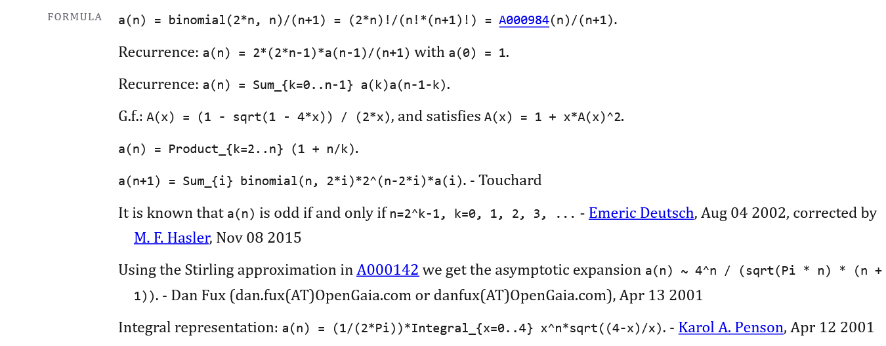
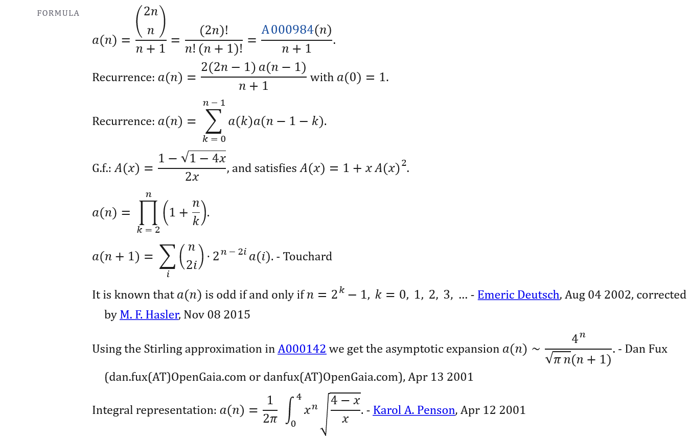
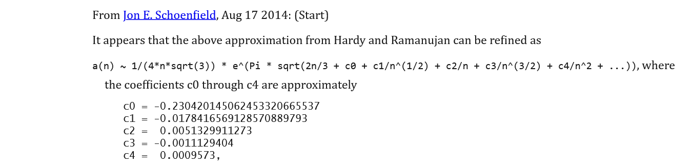
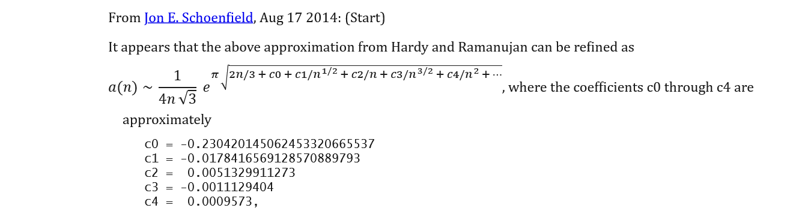

# oeisTypeset

Typeset the formulas on OEIS sequence pages (`https://oeis.org/Annnnnn`) in Firefox.

The OEIS writes formulas in plain text. oeisTypeset redraws them as mathematics, with fractions, sums, binomials, powers and roots, and leaves the prose around them alone.

| As the OEIS serves it                                                                 | With oeisTypeset                                                               |
| ------------------------------------------------------------------------------------- | ------------------------------------------------------------------------------ |
|  |  |

## Install

oeisTypeset has two pieces, and you need both:

* **The script** (`oeisTypeset.user.js`, runs in Violentmonkey) finds the formulas and typesets them.
* **The stylesheet** (`oeisTypeset.user.css`, runs in Stylus) decides how the page looks: the math font, the text face for lines with math, spacing between sections, and how A-numbers in formulas look.

The stylesheet styles names that the script adds to the page, so without the script it has nothing to attach to, and the page stays as the OEIS serves it.

Installing from these links also gives you updates.

1. Install [Violentmonkey](https://addons.mozilla.org/firefox/addon/violentmonkey/) and [Stylus](https://addons.mozilla.org/firefox/addon/styl-us/).
2. Click to open [oeisTypeset.user.js](https://github.com/hunterhogan/oeisTypeset/raw/refs/heads/main/dist/oeisTypeset.user.js). Violentmonkey offers to install it.
3. Click to open [oeisTypeset.user.css](https://github.com/hunterhogan/oeisTypeset/raw/refs/heads/main/oeisTypeset.user.css). Stylus offers to install it. Its one option, *Fractions inside fractions*, chooses full-size nested fractions (default) or TeX's shrinking.

[Don't use Chromium browsers.](https://scholarship.law.vanderbilt.edu/jetlaw/vol27/iss3/3/)

* chromewebstore.google.com/detail/violentmonkey/jinjaccalgkegednnccohejagnlnfdag
* chromewebstore.google.com/detail/stylus/clngdbkpkpeebahjckkjfobafhncgmne

The script loads the math renderer, [Temml](https://temml.org), once from jsDelivr. The version is pinned, and Violentmonkey caches it.

### If a link only shows text, or you have a local copy

#### Script

1. Click the Violentmonkey icon, then settings.
2. In the dashboard, click `+` and choose to create a new script from a file.
3. Browse to `dist/oeisTypeset.user.js`.

#### Stylesheet

Stylus's *load from file* option only accepts JSON, so it will not take this file. Stylus documents opening a local `.user.css` with Ctrl+O, or dragging it onto the tab bar. If that does not bring up an install page, paste it in:

1. Open any `https://oeis.org` page and click the Stylus icon. It should say no styles are installed.
2. Click the `+` icon. It is always visible and easy to miss. A CSS editor opens.
3. Make sure *Write new style as UserCSS* is unchecked. The import icon only appears while it is unchecked.
4. Click the import icon, paste the whole of `oeisTypeset.user.css` into the box, and save.
5. Check *Write new style as UserCSS*. The style does not work until you do.

A style installed this way does not update itself.

## Use

* Formulas are typeset when the page loads.
* Click a section name (FORMULA, COMMENTS) to switch that section between typeset and original text. Violentmonkey's menu has the same toggle for the whole page.
* Copying a selection copies the original OEIS text of every formula in it, so code you paste still runs.
* A-numbers inside formulas are clickable. Ctrl+click opens a new tab.

## What gets typeset

**Pages:** sequence pages, `https://oeis.org/A` followed by six digits. Search results, history pages and the wiki are left alone.

**Sections:** the name of the sequence, COMMENTS, and FORMULA. EXAMPLE, PROG, MAPLE, MATHEMATICA, LINKS, REFERENCES and CROSSREFS are never typeset.

**Inside a line:** only the math. In `a(n) is odd if and only if n=2^k-1`, the words stay text and `a(n)` and `n=2^k-1` are typeset. A stretch of a line counts as math if it holds an operator (`=`, `+`, `*`, `/`, `^`, `<=`, ...), a function call such as `a(n)` or `binomial(n,k)`, or a math word such as `Pi`, `oo`, `phi`, or `mod`. A word of English ends the math. Numbers on their own, dates, and page ranges such as `47-48` stay text.

### How the notation is drawn

The notation is the one in the [OEIS Style Sheet](https://oeis.org/wiki/Style_Sheet#Spelling_and_notation).

| You see in the OEIS                           | You get                                                                         |
| --------------------------------------------- | ------------------------------------------------------------------------------- |
| `x^(n-1)`, `a_n`                              | a superscript or subscript, without the parentheses                             |
| `(a+b)/(c+d)`                                 | a built-up fraction; a fraction in a denominator becomes a continued fraction   |
| `x^(1/2)`                                     | the fraction stays inline (`1/2`) inside an exponent or subscript               |
| `2*n`, `a(k)*a(n-k)`                          | `2n`, `a(k) a(n−k)`: multiplication without a sign, as in print                 |
| `2*3`                                         | `2·3`: a dot between two numbers, so they do not merge into `23`                |
| `2*A014140(n)`                                | `2 A014140(n)`: a thin space before an A-number, so it does not read `2A014140` |
| `2 X 3`                                       | `2×3`                                                                           |
| `Sum_{k=0..n}`, `Product_{k=1..n}`            | a summation or product sign with its limits above and below                     |
| `Integral_{x=0..4} f(x) dx`, `lim_{n->oo}`    | an integral with limits; a limit                                                |
| `binomial(n,k)`, `C(n,k)`                     | a binomial coefficient                                                          |
| `floor(x)`, `ceiling(x)`, `sqrt(x)`, `abs(x)` | floor and ceiling brackets, a root sign, bars                                   |
| `==`, `(mod m)`                               | `≡` and `(mod m)`                                                               |
| `<=`, `>=`, `!=`, `<>`, `~`, `->`, `+-`       | `≤`, `≥`, `≠`, `≠`, `∼`, `→`, `±`                                               |
| `oo`, `Pi`, `phi`, Greek letter names         | `∞`, `π`, `φ`, Greek letters                                                    |

## When something is not typeset

A formula that looks like math to you can stay as plain text. Each case below has a reason, and the toggle shows you which text the script worked from.

**The page or section is out of scope.** See [What gets typeset](#what-gets-typeset). A formula in EXAMPLE, or on a history page, is never typeset.

**The line is a diagram or a table.** If a line's spaces do layout work, the script does not touch the line, so the columns stay lined up. The line keeps the site's monospace font, and there is no gap between rows. A line counts as layout if it starts with two or more spaces, has three or more spaces between two values, or has a run such as `---`, `|||` or `===`.

| As the OEIS serves it                                                                  | With oeisTypeset                                                           |
| -------------------------------------------------------------------------------------- | -------------------------------------------------------------------------- |
|  |  |

Spaces that only line up an equation do not count. In `A076876(n)   = [T(n,3) -     T(n,2)]/2` each run of spaces touches an operator and the line holds a relation, so the line is typeset. The typeset formula ignores those spaces, and the original text view and copying keep them.

**The notation does not parse.** If the script cannot read a stretch of math with certainty, it leaves that stretch exactly as the OEIS wrote it. A line is never made worse. These cases stay as text:

* Umbral notation, such as `P(.,x)` and `(a.)^n`.
* Unbalanced brackets in the middle of a formula, and other typos. A `)` missing at the very end is accepted, because truncated continued fractions are written that way.
* Mathematica (`Table[...]`, `f[x]`). It is code, not notation.

**It is not math by the rules above.** A lone number, a lone letter, a date, or a page range stays text. In `the n-th term`, `n-th` is a word.

**Nothing on the page is typeset.** Then the script is not running. Check that Violentmonkey is on and the script is enabled, and that the page address is a sequence page. Another cause is that jsDelivr was blocked when the script first loaded Temml.

**Something is typeset, but wrong.** That is a bug. Open an [issue](https://github.com/hunterhogan/oeisTypeset/issues) with the A-number and the line. [How it works](README_HOW_IT_WORKS.md) explains how the script decides each case above, if you want to see where it went wrong.

## Known limits

* The OEIS serves pages with an HTML 3.2 doctype, so browsers render in quirks mode. Temml prints a console warning about this. MathML layout is unaffected.
* History pages (`https://oeis.org/history?seq=…`, `https://oeis.org/history/view?seq=…`) are not typeset. They mark changes with underlined additions and deletions inside the text, and typesetting would hide those marks.

## License

The [OEIS](https://oeis.org/wiki/The_OEIS_End-User_License_Agreement) holds copyrights for one or more works in `corpus/` and "made available under the [Creative Commons Attribution Share-Alike 4.0 license (CC-BY-SA-4.0)](https://creativecommons.org/licenses/by-sa/4.0/)."

## My recovery

By law, authors retain their copyrights unless they grant exceptions. The [Attribution-NonCommercial 4.0 International Deed](https://github.com/hunterhogan/mapFolding#License-1-ov-file) outlines how you may use this work.

The restriction on commercial use (without a license) limits advantage-taking, unjust enrichment, and exploitation. You would be morally wrong if you were to enrich yourself by using this work while I am denied healthcare, housing, security of property, and the safety of my person.

To obtain and retain the right to use this work, you incur the cost of attributing the work to me. Your nominal cost might accrue as a benefit that mitigates my suffering or saves my life.
